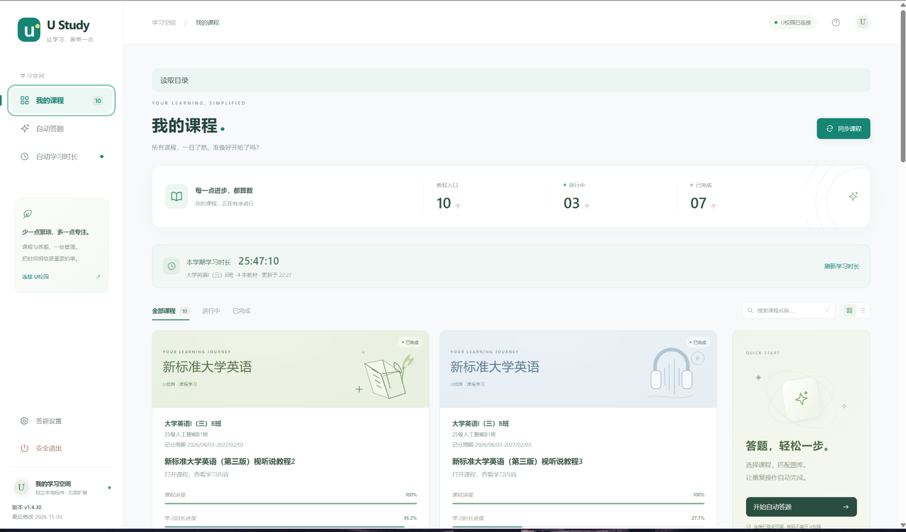
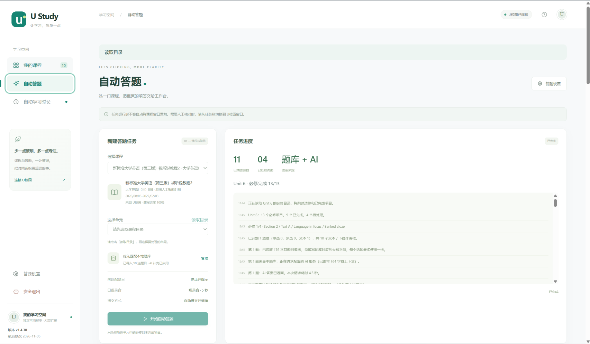
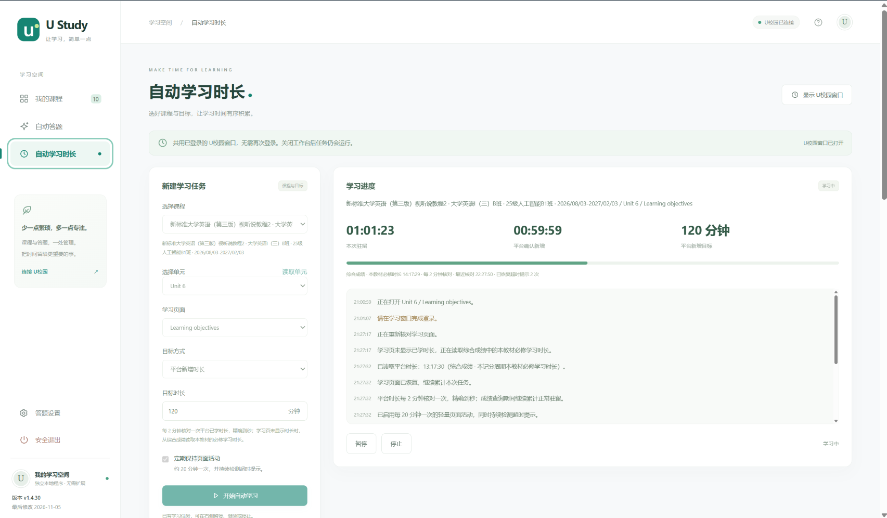

# U Study · U校园学习工作台

Windows 本地运行的课程与学习工作台，支持课程同步、单元目录、题库匹配和 AI 辅助填答。通过独立的 Edge / Chrome 窗口登录，工作台和个人数据保存在自己的电脑上。

**当前版本：1.4.30** · [下载最新版](https://github.com/codezjj777/UCampus/releases/latest) · [详细使用说明](u-study/README.md) · [更新日志](u-study/CHANGELOG.md) · [发布与公开仓库](docs/RELEASING.md)

## 下载后直接使用

1. 打开右侧 **Releases**，下载 **`U-Study-1.4.30-windows-x64.zip`**。
2. 右键 ZIP → **全部解压缩**，将整个文件夹解压到自己的目录。不要在压缩包内运行。
3. 双击 **`一键启动.cmd`**。便携版包含 Node.js 和运行依赖，无需另外安装 Node.js 或执行 npm 命令。
4. 程序打开本地工作台及 U校园专用登录窗口。正常登录后，回工作台点击 **同步课程**。
5. 使用结束后点击工作台左下角 **安全退出**，等待保存记录、关闭学习窗口并退出后台。也可双击 **`一键停止.cmd`**。只关闭工作台网页不会停止后台服务。

运行环境：**Windows 10 / 11 64 位（x64），已安装 Microsoft Edge 或 Google Chrome**。登录平台、同步课程和调用 AI 需要联网。发布包不含浏览器、个人账号、真实题库、API Key 或可选语音模型。

GitHub 自动生成的 `Source code (zip)` 是源码包。希望解压即用时请选择上面的 Windows 便携包。私有仓库下载需要登录有访问权限的 GitHub 账号。

## 界面预览

### 我的课程



### 自动答题



### 自动学习时长



## 首次使用

1. **登录平台**：在程序打开的专用窗口登录 U校园并完成验证码。平常浏览器中的登录不会自动导入。
2. **同步课程**：点击「同步课程」，选择课程和单元，读取目录。同步和查看目录不需要 AI Key。
3. **配置答案来源**：在「答题设置」导入自己的 JSON 题库，或填写兼容 Chat Completions 的完整 HTTPS 接口、模型名称和 API Key，测试后保存。
4. **开始任务**：从课程卡片点击「自动答题」，选择单元。默认在最终提交前等待人工核对；检查题页后手动提交，再点击「继续核对」。
5. **查看结果**：以平台目录确认的完成状态为准，不支持或材料不足的项目保留为待手动处理。

题库格式见 [示例 JSON](u-study/dist/question-bank.example.json)，示例不是现成课程答案。图片及视频画面题需要模型支持识图。启用自动提交后可能影响平台课程成绩，请按自己的需要设置并核对答案。

## 可选：听力识别

只查看课程或处理普通文本题不需要 Python。需要识别缺少字幕的听力材料或抽取视频画面时：

1. 安装 Python 3.10–3.13。
2. 双击 `u-study` 文件夹内的 **`准备听力识别.cmd`**。
3. 首次下载 Python 组件和约 148 MB 的英文模型，完成后重新启动。

详见 [听力与口语](u-study/README.md#听力与口语)。

## 数据与更新

API Key、登录状态、课程、任务、题库和语音缓存保存在 **`u-study/.runtime/`**。当前版本的已保存 Key 为本机明文配置，不要分享这个目录。启用 AI 时，题目及相关材料会发送到自己配置的接口。

更新前先停止程序并备份 `.runtime/`，将新版解压到新目录；需要保留数据时，把旧版的 `u-study/.runtime/` 复制到新版相同位置再启动。仓库和发布包均排除这份个人数据。

## 常见问题

| 情况 | 处理方法 |
| --- | --- |
| 双击后没有工作台 | 确认完整解压并安装 Edge / Chrome，查看 `u-study/.runtime/server-error.log` 和 `server.log`。 |
| 浏览器连接不上 | 启动后访问 [本地工作台](http://127.0.0.1:4173/)，不要直接打开 `dist/index.html`。 |
| 源码包提示没有 Node.js | 改用 Releases 的便携版；源码运行需要 Node.js 20.19+。 |
| 登录后看不到课程 | 确认登录的是程序专用窗口，回到工作台重新同步课程。 |
| AI 测试失败 | 检查完整接口、模型、Key、服务商额度和网络；看图还需模型支持识图。 |
| 页面或题型无法识别 | 保留题页手动处理，详细说明中有适配设置和日志位置。 |

## 从源码运行与开发

需要 Node.js 20.19+ 及 Edge / Chrome，在项目根目录运行：

```powershell
cd u-study
npm.cmd ci
npm.cmd start
```

也可双击项目根目录的 `一键启动.cmd`，首次自动安装生产依赖。

验证与打包（在 `u-study` 目录执行）：

```powershell
npm.cmd test
npm.cmd run build
npm.cmd run release            # 源码运行包 .tgz
npm.cmd run release:windows    # Windows x64 便携版 .zip
```

输出位于 `u-study/.cache/releases/`。便携版构建从 Node.js 官方站点下载固定版本运行时并核对官方 SHA-256，按锁文件安装生产依赖。具体步骤见 [发布说明](docs/RELEASING.md)。
